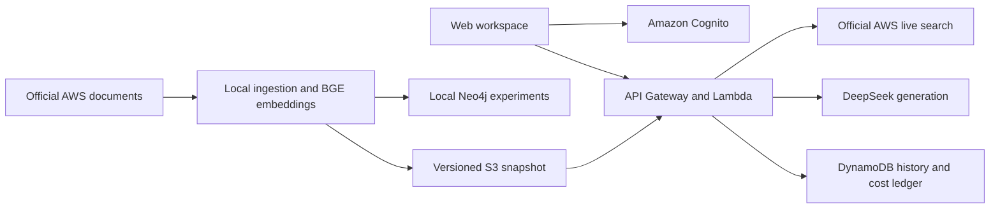

# Enterprise Knowledge Graph Assistant

A source-grounded AWS documentation assistant with Vietnamese and English answers, claim-level citations, private history, and reproducible retrieval experiments.

[Live AWS demo](https://cyg0uvml94.execute-api.us-east-1.amazonaws.com/) · [Architecture](docs/architecture.md) · [Development](docs/development.md) · [Evaluation](docs/evaluation.md) · [Security](docs/security-overview.md)

## What you can do

- Investigate AWS workflows using official live documentation search or a versioned pilot snapshot.
- Inspect the source passage behind each statement, revisit your own questions, and export an investigation brief.
- Explore indexed documents and compare recorded vector, hybrid, and graph retrieval results in the dashboard.
- Create an account with a username, email and website password; verify email before accessing the workspace.

The owner has confirmed registration, email verification, account access, and a Vietnamese question returning an answer, sources and history. These are user-reported functional checks; broader answer quality remains under evaluation.

## Architecture



The cloud demo serves hybrid snapshot retrieval and official live search. Neo4j supports local graph experiments; a managed graph database is not running in AWS. BGE-small-en-v1.5 runs locally or as an ONNX CPU model in Lambda, with 384-dimensional vectors. Generation uses DeepSeek.

## Run locally

Prerequisites: Python 3.12, Node.js 22 or 24, and [uv](https://docs.astral.sh/uv/getting-started/installation/).

```sh
uv sync --frozen
uv run python -m app.cli fixture-demo --output-root results/fixture-demo
```

This uses synthetic data and makes no AWS or model API calls. To explore the interface with synthetic records:

```sh
uv run python -m scripts.preview_web_upgrade --serve --port 8765
```

Open `http://127.0.0.1:8765/`. The preview is explicitly labeled and does not authenticate against the live service. Real-corpus preparation, model downloads and optional cloud operations are documented in [Development](docs/development.md).

## Test

```sh
npm ci --ignore-scripts
uv run python -m app.cli prepare-tokenizer
uv run pytest -q
uv run ruff check app infra scripts tests
npm run ui:test
```

Dependency and tokenizer preparation download public assets. Tests use fixtures and mocked providers; they do not require AWS credentials or paid inference. CI runs the same checks and synthesizes infrastructure without deployment.

## Results and limits

The serving pilot contains 20 official documents and 236 chunks. A separate live-search path expands coverage without claiming that all AWS documentation has been downloaded or indexed.

| Recorded experiment | CompleteEvidence@5 | Scope |
|---|---:|---|
| Vector | 8/12 | Development questions with AI-draft evidence labels |
| Hybrid | 10/12 | Same corpus and retrieval budget |
| Draft graph expansion | 10/12 | No demonstrated improvement over hybrid |
| Mention-only graph ablation | 8/12 | Not selected for serving |

These are retrieval diagnostics, not answer-accuracy scores. Graph answering remains gated, and the broader release quality gate has not been met. [Evaluation](docs/evaluation.md) explains the experiment design, known failure modes and remaining work.

The implementation includes owner-scoped history, conditional account enrollment, durable idempotency, bounded token usage, and shared cost admission. Application limits do not cap every AWS charge. No automatic provider retry follows an ambiguous completion.

## Repository

`app/` contains retrieval, generation, authorization and accounting. `frontend/` contains the browser workspace. `infra/` contains AWS CDK definitions. `schemas/`, `configs/`, `scripts/` and `tests/` support contracts, reproducibility and validation.

Local learning journals, planning notes, raw results, credentials, downloaded documents, model weights and build outputs are intentionally excluded from Git.

## License

Original code is [MIT licensed](LICENSE). AWS source material, dependencies and model artifacts retain their own terms; see [NOTICE](NOTICE.md).
