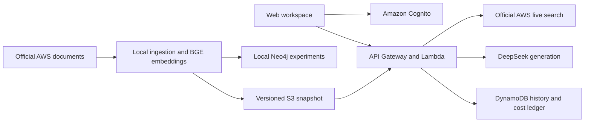

# Enterprise Knowledge Graph Assistant

A source-grounded AWS documentation assistant with Vietnamese and English answers, claim-level citations, private history, and reproducible retrieval experiments.

[Live AWS demo](https://cyg0uvml94.execute-api.us-east-1.amazonaws.com/) · [Architecture](docs/architecture.md) · [Development](docs/development.md) · [Evaluation](docs/evaluation.md) · [Security](docs/security-overview.md)

## Delivery status — 28 October 2026

The deployed application includes verified-email accounts, Vietnamese/English AWS documentation answers, source inspection, private question history, investigation exports, and guided onboarding. **Live Compare** also runs BM25, vector, hybrid and hybrid + reranker retrieval on a separate **316-document / 2,978-chunk** collection, with saved runs, traces and JSON export. Live Compare does not generate answers on that collection.

The recorded pilot remains **20 documents / 236 chunks**. The **319-document / 3,024-chunk** candidate, new Graph/Q/QB workflows and eight detailed method pages are local work and have not been released to AWS. Graph in the existing recorded lab is an experimental recorded result, not live graph answering.

See the [Vietnamese progress report and presentation walkthrough](docs/progress-report.md) for the feature checklist, evidence levels and remaining work. A fresh public readback matched all 13 deployed assets and confirmed that the status API rejects unauthenticated access; authenticated workflows were not rerun in that check.

## What you can do

- Investigate AWS workflows using official live documentation search or a versioned pilot snapshot.
- Inspect the source passage behind each statement, revisit your own questions, and export an investigation brief.
- Explore indexed documents and compare recorded vector, hybrid, and graph retrieval results in the dashboard.
- Run a retrieval comparison on the separate 316-document collection using four live methods, then inspect sources, saved traces and exported results.
- Create an account with a username, email and website password; verify email before accessing the workspace.

The owner has confirmed registration, email verification, account access, and a Vietnamese question returning an answer, sources and history. These are user-reported functional checks; broader answer quality remains under evaluation.

## Architecture



The cloud demo serves hybrid snapshot retrieval and official live search. Neo4j supports local graph experiments; a managed graph database is not running in AWS. BGE-small-en-v1.5 runs locally or as an ONNX CPU model in Lambda, with 384-dimensional vectors. Generation uses DeepSeek.

## Run locally

Prerequisites: Python 3.12, Node.js 22 or 24, and [uv](https://docs.astral.sh/uv/getting-started/installation/).

```sh
uv sync --frozen
uv run python -m app.cli fixture-demo --output-root results/fixture-demo
```

This uses synthetic data and makes no AWS or model API calls. To explore the interface with synthetic records:

```sh
uv run python -m scripts.preview_web_upgrade --serve --port 8765
```

Open `http://127.0.0.1:8765/`. The preview is explicitly labeled and does not authenticate against the live service. Real-corpus preparation, model downloads and optional cloud operations are documented in [Development](docs/development.md).

## Test

```sh
npm ci --ignore-scripts
uv run python -m app.cli prepare-tokenizer
uv run python -m pytest -q
uv run ruff check app infra scripts tests
npm run ui:test
```

Dependency and tokenizer preparation download public assets. Tests use fixtures and mocked providers; they do not require AWS credentials or paid inference. CI runs the same checks and synthesizes infrastructure without deployment.

## Results and limits

The serving pilot contains 20 official documents and 236 chunks. Live Compare uses a separate 316-document / 2,978-chunk collection for retrieval only. A separate live-search answer path expands coverage without claiming that all AWS documentation has been downloaded or indexed. These scopes must not be combined into one reported corpus or benchmark.

The expanded development set has 50 scenarios, each in English and Vietnamese: 40 answerable and 10 corpus-unanswerable per language. Translations share intent groups; 100 language inputs are not 100 independent scenarios. Evidence labels remain AI drafts pending human review.

| Retrieval configuration | English CompleteEvidence@5 | Vietnamese CompleteEvidence@5 |
|---|---:|---:|
| BM25 | 34/40 | 17/40 |
| Vector | 33/40 | 21/40 |
| Hybrid | 37/40 | 25/40 |
| Mixed graph, 1 / 2 hops | 37/40 each | 24/40 each |
| Mention-only ablation | 37/40 | 24/40 |
| Relation-only ablation, 1 / 2 hops | 37/40 each | 24/40 each |

All eight configurations share the frozen corpus, vectors and resource limits. Vietnamese here means raw Vietnamese retrieval against English sources, without query rewriting; the live-search workflow is different. Graph has not demonstrated a benefit over hybrid. These are provisional retrieval diagnostics, not answer accuracy or a held-out benchmark. Historical 8/12 vector and 10/12 hybrid results are retained separately.

The [public receipts](benchmarks/expanded-development-v1/summary.json) include 800 recorded retrieval rows and a model-free range audit. [Evaluation](docs/evaluation.md) explains controls, source provenance, bilingual answer experiments, review requirements and limitations.

A separate 100-response paired-language experiment passed strict schema/source checks on 98 attempts; two failures are retained. Correctness and citation entailment still require human review. This is not a 98% answer-accuracy claim.

The implementation includes owner-scoped history, conditional account enrollment, durable idempotency, bounded token usage, and shared cost admission. Application limits do not cap every AWS charge. No automatic provider retry follows an ambiguous completion.

## Repository

`app/` contains retrieval, generation, authorization and accounting. `frontend/` contains the browser workspace. `infra/` contains AWS CDK definitions. `schemas/`, `configs/`, `scripts/` and `tests/` support contracts, reproducibility and validation.

Local learning journals, planning notes, raw results, credentials, downloaded documents, model weights and build outputs are intentionally excluded from Git.

## License

Original code is [MIT licensed](LICENSE). AWS source material, dependencies and model artifacts retain their own terms; see [NOTICE](NOTICE.md).
